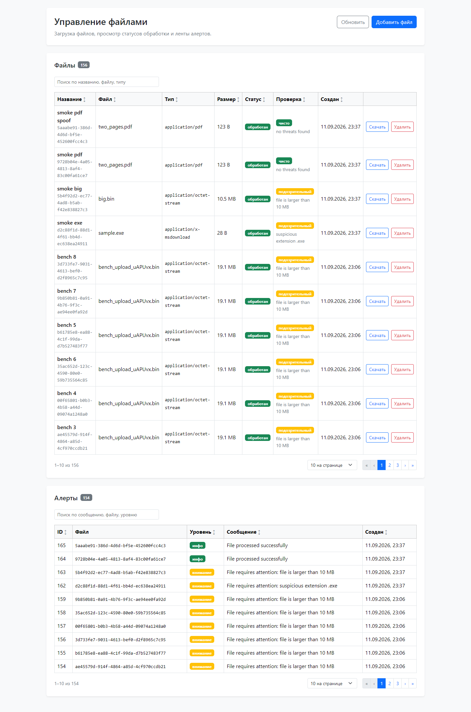

Python + React

**Запуск:**
1. ```cp .env.example .env.dev```
2. ```docker compose -f docker-compose.dev.yml up```
3. ```docker exec -it backend alembic upgrade head```

**Тесты и линт бэкенда** (без Postgres и Redis, но внутри контейнера, чтобы не ставить Python 3.14 локально):
```
docker compose -f docker-compose.dev.yml run --rm --no-deps backend sh -c "ruff check . && pytest"
```

**Проверки фронта:** ```cd frontend && npm ci && npm run check```

**Прогон сценариев на живом стенде:** ```./scripts/smoke.sh```

**фронт:** ```http://localhost:3000/test```

**бэк:** ```http://localhost:8000/docs```



---

# Стек и версии

Версии — из lock-файлов (`backend/uv.lock`, `frontend/package-lock.json`), то есть ровно то,
что ставится в образ. В `pyproject.toml` заданы нижние границы, в `package.json` — точные
версии без `^`.

## Бэкенд

Python 3.14 (`python:3.14-slim`), пакетный менеджер uv. Инфраструктура: `postgres:18`, `redis:8`.

| Библиотека | Версия | Зачем |
|---|---|---|
| fastapi | 0.135.3 | HTTP-слой, роутеры, DI |
| starlette | 1.0.0 | транзитивно через FastAPI: `FileResponse`, `Request`, коды статусов |
| uvicorn | 0.42.0 | ASGI-сервер |
| pydantic | 2.12.5 | схемы запросов и ответов |
| pydantic-settings | 2.15.0 | конфигурация из окружения с валидацией |
| sqlalchemy | 2.0.48 | ORM, async-движок и сессии |
| asyncpg | 0.31.0 | драйвер Postgres |
| alembic | 1.18.4 | миграции |
| celery | 5.6.3 | очередь задач (extra `redis`) |
| redis | 6.4.0 | транзитивно через `celery[redis]`: клиент брокера |
| kombu / billiard | 5.6.2 / 4.2.4 | транзитивно через Celery: транспорт сообщений и prefork-пул |
| aiofiles | 25.1.0 | потоковая запись и чтение файлов без блокировки event loop |
| python-multipart | 0.0.22 | разбор multipart при загрузке |

Только для разработки и тестов (группа `dev`; при сборке с `UV_NO_DEV=1` в образ не попадает):

| Библиотека | Версия | Зачем |
|---|---|---|
| pytest | 9.1.1 | тесты |
| pytest-asyncio | 1.4.0 | async-тесты и фикстуры |
| httpx | 0.28.1 | клиент к ASGI-приложению в тестах API |
| aiosqlite | 0.22.1 | SQLite вместо Postgres в интеграционных тестах |
| ruff | 0.16.7 | линтер и форматтер |

## Фронтенд

Node 22 (`node:22-alpine`), npm.

| Библиотека | Версия | Зачем |
|---|---|---|
| next | 16.1.6 | фреймворк: app router, `basePath: /test`, standalone-сборка |
| react / react-dom | 18.3.1 | UI |
| react-bootstrap | 2.10.10 | компоненты: таблица, модальное окно, бейджи, пагинация |
| bootstrap | 5.3.8 | стили |

Только для разработки:

| Библиотека | Версия | Зачем |
|---|---|---|
| typescript | 5.9.3 | типизация, `strict: true` |
| @types/react / @types/react-dom | 18.3.31 / 18.3.7 | типы под React 18 |
| @types/node | 22.20.2 | типы Node; требование vitest 5 |
| eslint | 9.39.5 | линтер |
| eslint-config-next | 16.1.6 | правила Next, React Hooks, TypeScript |
| eslint-config-prettier | 10.1.8 | снимает правила, конфликтующие с Prettier |
| prettier | 3.9.6 | форматирование |
| vitest | 5.0.0 | тесты чистых функций (тянет vite 8.3.0) |

**Совместимость Next 16 и React 18.** Next 16 допускает React 18.2+ в peer-зависимостях,
а в app router использует собственную вшитую копию React, поэтому пара 16.1.6 / 18.3.1
собирается и работает — подтверждено сборкой и браузерным прогоном. Переход на React 19 —
отдельное решение, в задание не входящее.

---

# Реализация

Работа идёт по этапам, история коммитов — часть решения. Разбор проблем и обоснование
архитектуры лежат в `docs/`:

- [docs/behaviour.md](docs/behaviour.md) — эталонное поведение исходной версии, снятое на живом
  стенде: таблица «вход → выход» по конвейеру обработки и HTTP-контракт. Это контракт
  рефакторинга: всё, кроме явно помеченных дефектов, должно продолжать работать так же.
  Раздел 3a — что в поведении изменилось осознанно и почему.
- [docs/audit.md](docs/audit.md) — список найденных проблем по группам (корректность,
  архитектура, производительность, фронтенд, инфраструктура), у каждой — чем грозит, что делаем
  и чем факт подтверждён. Номера пунктов (A1, Б3, И2…) используются в комментариях кода
  и ниже.
- [docs/architecture.md](docs/architecture.md) — целевая структура бэкенда, правило
  зависимостей и обоснование каждой границы; написан до кода.

## Архитектура бэкенда

Было четыре файла, в которых конфигурация, доступ к данным, работа с диском, бизнес-правила
и HTTP лежали вперемешку: `service.py` бросал `HTTPException`, движок БД создавался на импорте
модуля, правила детекта угроз жили внутри тела celery-задачи. Стало:

```
api  →  services  →  repositories  →  models
              ↘         ↘
             domain    storage
```

- **`domain/`** — правила детекта, определение типа по сигнатуре, накопители метаданных.
  Чистые функции: ни FastAPI, ни SQLAlchemy, ни Celery, ни файловой системы. Это главное
  решение: единственная настоящая бизнес-логика проекта теперь тестируется за секунды и без
  докера, а раньше для проверки «`.exe` помечается подозрительным» нужны были Redis, Postgres
  и файл на диске.
- **`repositories/`** — только запросы; не нашли — вернули `None`.
- **`services/`** — сценарии и транзакции; бросают доменные ошибки, про HTTP не знают.
- **`storage/`** — протокол `FileStorage` и локальная реализация; потоковая запись и чтение
  живут здесь, сервисам об этом знать не нужно. Переезд на S3 — новый класс, а не правка сервисов.
- **`api/`** — единственное место с HTTP: роутеры, схемы ответов и перевод доменных ошибок
  в коды.
- **`worker/`** — такой же клиент сервисов, как `api/`: задача разбирает аргументы и вызывает
  тот же сценарий. Ресурсы инициализируются после `fork`, а не на импорте.

Что осознанно **не** сделано — отдельный Unit of Work, CQRS, мапперы «ORM → сущность → DTO»,
микросервисы — и почему, разобрано в [architecture.md](docs/architecture.md#что-осознанно-не-делаем).
Общее правило: слой появляется, когда у него есть своя причина меняться.

Правило зависимостей проверяется тестом
[`tests/unit/test_domain_purity.py`](backend/tests/unit/test_domain_purity.py): он читает
импорты всех модулей и падает, если `domain/` узнал про фреймворк или `fastapi` появился
за пределами `api/`.

## Что исправлено по дороге

Полный список с подтверждениями — в [audit.md](docs/audit.md). Коротко, по группам:

| Группа | Что было | Что стало |
|---|---|---|
| Корректность | Удаление любого обработанного файла падало с 500 на внешнем ключе (A1); статус `processing` коммитился вместе с результатом и снаружи не наблюдался (A2); при недоступном Redis клиент получал 500 на уже сохранённый файл (A7); файл писался на диск до коммита и удалялся до коммита, любой сбой давал рассинхрон (A8); тип файла брался из заголовка клиента и на нём же строилась проверка (A9); лимита загрузки не было (A10); счётчик страниц PDF искал только `/Type /Page` с пробелом (A11) | Каскад на FK и в ORM; статус — отдельной транзакцией до тяжёлой работы; постановка задачи не роняет загрузку; порядок «сначала база, потом диск» с компенсацией; тип — по сигнатуре в первых байтах; `413` посреди приёма; оба варианта записи и отсечение `/Type /Pages` |
| Надёжность конвейера | Исчезнувший файл обрывал цепочку молча, ретраев не было (A4); повтор задачи создавал дубль алерта (A5) | `acks_late`, `autoretry_for` с backoff, лог обрыва; алерт идемпотентен по паре (файл, уровень) |
| Конфигурация | `DB_URL` собирался из `os.environ.get()` и мог содержать литерал `None` (A6); код читал `REDIS_URL`, окружение задавало `CELERY_BROKER_URL` (A3) | pydantic-settings: валидация на старте, единые имена переменных, `.env.example` |
| Данные | Статусы — голые строки в семи местах (Б5); ORM-модель служила и ответом API (Б6); списки без пагинации и индексов (Б7) | Перечисления с CHECK на стороне базы; отдельные pydantic-схемы; `limit`/`offset` и индексы под сортировку и джойн |
| Инфраструктура | Сборка фронта падала на несуществующем `.env.production` (И1); в образе бэкенда не было `alembic.ini` и миграций (И2); нет healthcheck и `depends_on` на Redis (И3, И4); плавающий тег Postgres (И5); Postgres на нестандартном порту внутри контейнера (И6); хранилище файлов работало только благодаря совпадению bind-mount'ов (Б4) | Всё перечисленное — в `docker-compose.dev.yml` и Dockerfile'ах: healthcheck'и с `condition: service_healthy`, `postgres:18`, штатный 5432 внутри, общий именованный том под файлы, миграции в образе |

Миграция одна и новая (`18c18e2d3bf6`), исходная не тронута; `alembic upgrade head`
проверен с нуля в чистом образе без bind-mount.

## Производительность

### Замер «до»

Скрипт: [scripts/bench_upload.sh](scripts/bench_upload.sh). Восемь параллельных загрузок файла
20 МБ, одновременно — пятнадцать последовательных `GET /files`; замеряется время лёгкого
запроса к списку.

```
./scripts/bench_upload.sh 8 20
```

| `GET /files` | avg | max |
|---|---|---|
| без нагрузки | 0.006 s | 0.009 s |
| во время восьми параллельных загрузок | 0.178 s | **1.715 s** |

Лёгкий запрос к списку файлов замедляется в тридцать раз. Причина — не база и не сеть:
`create_file` объявлена `async`, но пишет файл синхронным `stored_path.write_bytes(content)`,
а перед этим вычитывает его целиком в память через `await upload_file.read()`. Синхронная
запись блокирует event loop, поэтому на время сохранения одного файла приложение перестаёт
отвечать **на все** запросы. То же самое в celery-задачах: `read_text` и `read_bytes` внутри
`async` функций.

Побочный эффект той же природы: пик памяти — два-три размера файла на каждую параллельную
загрузку (тело в памяти, его копия при записи, повторное чтение при извлечении метаданных),
причём лимита на размер загрузки нет вообще.

Отдельно видно на стенде: celery-воркер держит десять отдельных соединений к Postgres при
шестнадцати форках — движок SQLAlchemy создаётся на импорте модуля, то есть в родительском
процессе до `fork`, и пул между задачами не переиспользуется.

### Замер «после»

Тот же скрипт, те же параметры, после перевода загрузки на потоковую запись через `aiofiles`:

| `GET /files` | было avg | стало avg | было max | стало max |
|---|---|---|---|---|
| без нагрузки | 0.006 s | 0.005 s | 0.009 s | 0.005 s |
| во время восьми параллельных загрузок | 0.178 s | **0.009 s** | 1.715 s | **0.042 s** |

Под нагрузкой худший ответ стал быстрее в сорок раз, а средний вернулся к значению «без
нагрузки»: event loop больше не простаивает на записи файла. Что изменилось:

- запись идёт чанками по 1 МБ через `aiofiles`, то есть в пуле потоков, а не в корутине;
- тело загрузки больше не вычитывается целиком: размер и первые байты считаются тем же
  единственным проходом, которым файл пишется на диск;
- появился лимит размера загрузки — файл сверх лимита отклоняется прямо посреди приёма
  (`413`), а недописанный обрубок удаляется.

### Четыре кандидата на «неочевидную оптимизацию»

Задание намекает на одну конкретную. Кандидатов по коду четыре; сделаны три, четвёртый
разобран и отложен осознанно.

**1. Асинхронный код, который на деле блокирующий.** Самый вероятный ответ, и именно его
показывает замер выше. Вызов выглядит асинхронным, работает синхронно — отсюда и
«неочевидность». Сделано: весь файловый ввод-вывод через `aiofiles`.

**2. Файл в памяти целиком, и не один раз.** `await upload_file.read()`, затем копия при
`write_bytes`, затем повторное чтение в задаче извлечения метаданных. Сделано вместе с
первым: один проход при загрузке, потоковое чтение при извлечении метаданных —
накопители в `domain/metadata.py` принимают файл по кускам и корректно обрабатывают
разрезы посреди многобайтового символа или искомой подстроки.

**3. Пул соединений, созданный до `fork`.** `create_async_engine` вызывался на импорте
`tasks.py`, то есть в родительском процессе Celery; дочерние процессы наследовали
чужие сокеты. Сделано: движок создаётся лениво, а в `worker_process_init` ссылка на него
сбрасывается — каждый процесс строит свой пул. Замер тем же бенчмарком, `pg_stat_activity`
после обработки 24 задач на 16 форках:

| Соединений к Postgres от воркера | было | стало |
|---|---|---|
| после серии из 8 загрузок | 10 | 5 |

Число само по себе небольшое, важнее другое: соединения теперь принадлежат процессам,
которые их открыли, и переиспользуются между задачами внутри процесса.

**4. Цепочка из трёх задач вместо одного прохода.** `scan → extract → alert` — три постановки
в очередь, три сессии, три чтения одной строки. Объединить их в один сценарий просто
(в тестах именно так и делается: `run_pipeline` в
[`test_file_service.py`](backend/tests/integration/test_file_service.py)), но три задачи —
это ещё и три точки ретрая с разной стоимостью: скан дешёвый, извлечение метаданных читает
файл. **Оставлено как есть**: выигрыш — две постановки в очередь на файл, потеря — гранулярность
повторов. Если бы объединять, то через `celery.chain` с передачей результата, а не через
склейку в одну задачу.

## Проверки

Уровни, а не количество — важнее показать, что каждый слой проверяется там, где ему
положено:

- **Юнит, домен** (`tests/unit/`): таблица из `behaviour.md` лежит в `parametrize` построчно;
  накопители метаданных гоняются на всех размерах чанка от одного байта; хранилище проверяется
  на лимит посреди потока и на чистку обрубков. Плюс тест на правило зависимостей.
- **Интеграционные, без докера** (`tests/integration/`): сервис и HTTP-контракт на SQLite
  во временном каталоге. Сценарий конвейера вызывается напрямую, без Celery; регрессии на
  A1, A2, A5, A7, A8, A10 названы в тестах по номерам.
- **Smoke на живом стенде** ([scripts/smoke.sh](scripts/smoke.sh)): то же самое через Postgres,
  Redis и настоящего воркера — 23 проверки, включая подмену Content-Type и удаление файла
  с алертом.

- **Фронт** (`frontend/src/**/*.test.ts`, Vitest): форматтеры, сортировка и фильтр таблицы,
  представление статусов, уровни алертов. Плюс `tsc --noEmit`, ESLint с правилами слоёв
  и Prettier — всё вместе `npm run check`.
- **Линт бэкенда**: ruff (`E`, `F`, `I`, `UP`, `B`, `ASYNC`) и `ruff format --check`.

**CI.** [.github/workflows/ci.yml](.github/workflows/ci.yml): три задания — бэкенд (ruff +
pytest), фронт (typecheck + lint + format + vitest + `next build`) и smoke: поднимает стенд
через `docker compose`, применяет миграции и гоняет `scripts/smoke.sh`. Стек компании —
GitLab, поэтому рядом лежит [.gitlab-ci.yml](.gitlab-ci.yml) с теми же двумя заданиями
без smoke: ему нужен docker-in-docker, а это зависит от инсталляции.

Что не покрыто и почему: особенности Postgres (каскад на уровне СУБД, типы) проверяются
только smoke-прогоном — testcontainers ради тестового не тянул. Компонентные тесты и e2e
на фронте легли бы поверх (Testing Library, Playwright), но для тестового не окупаются:
живой прогон в браузере сделан руками при сдаче этапа.

## Что осталось за рамками

Видно дальше задания, но в него не входит:

- **S3 вместо локального диска** — интерфейс `FileStorage` под это готов, реализация нет.
- **Настоящий антивирус** вместо проверки расширения и сигнатуры: например, ClamAV за тем
  же протоколом, что и сканер.
- **Аутентификация и права** — сейчас API открыт.
- **Observability**: логи структурные, но метрик и трассировки нет.
- **Уборка осиротевших файлов**: если удаление с диска не удалось после коммита, файл
  остаётся; нужна периодическая задача сверки.

## Слои фронтенда

Было: один `page.tsx` на 367 строк. Стало — FSD-подобная раскладка, где `page.tsx` только
собирает виджеты, а правило зависимостей `app → widgets → features → entities → shared`
проверяется ESLint, а не договорённостью. Подробно — в [docs/frontend.md](docs/frontend.md).

```
src/
├── app/         layout, page (композиция), error, loading
├── shared/      http-клиент, конфиг, форматтеры, useQuery/usePagedQuery, DataTable
├── entities/    file, alert: типы, статусы как union, API, хуки, колонки
├── features/    upload-file, delete-file, refresh-data
└── widgets/     files-table, alerts-table
```

Главное изменение поведения — **опрос статусов** (Г3): пока на странице есть файл в статусе
`uploaded` или `processing`, списки файлов и алертов обновляются раз в три секунды сами
и перестают, когда все обработаны. Это то, чего не хватало интерфейсу поверх асинхронного
конвейера: раньше пользователь видел `uploaded` и жал «Обновить», гадая, работает ли
обработка. Остальное по списку из аудита: `AbortController` на запросах, нейтральный бейдж
до проверки вместо зелёного, ошибка формы внутри модального окна, адрес API из окружения,
один форматтер дат на модуль, `strict: true`, зафиксированные версии, ESLint, Prettier,
Vitest. Таблицы получили сортировку, поиск и серверную пагинацию через общий `DataTable`.

```
cd frontend && npm ci && npm run check   # typecheck + lint + format + tests
```

## Оговорка

Коммерческий опыт — TypeScript и Node; Python здесь рабочий инструмент второго ряда.
Решение показывает то, что от языка не зависит: асинхронность и где она ломается,
транзакции и порядок побочных эффектов, очереди и идемпотентность, границы слоёв.
